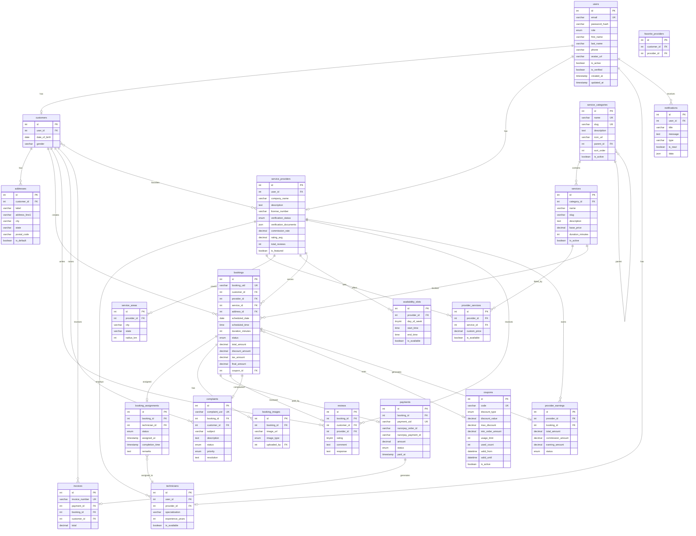

# HomeServe Technologies - ER Diagram

## Entity Relationship Diagram

## Table Relationships Summary

| From | To | Type | Description |
|------|-----|------|-------------|
| users | customers | 1:0..1 | A user may be a customer |
| users | service_providers | 1:0..1 | A user may be a provider |
| users | technicians | 1:0..1 | A user may be a technician |
| customers | addresses | 1:N | Customer has multiple addresses |
| customers | bookings | 1:N | Customer creates bookings |
| service_providers | technicians | 1:N | Provider employs technicians |
| service_providers | provider_services | 1:N | Provider offers services |
| service_categories | services | 1:N | Category contains services |
| bookings | booking_assignments | 1:0..1 | Booking may have assignment |
| bookings | payments | 1:0..1 | Booking may have payment |
| bookings | reviews | 1:0..1 | Booking may have review |
| bookings | complaints | 1:0..1 | Booking may have complaint |

## Database Statistics
- **23 tables** in the schema
- **45+ foreign key relationships**
- **30+ indexes** for query optimization
- **8 CHECK constraints** for data integrity

